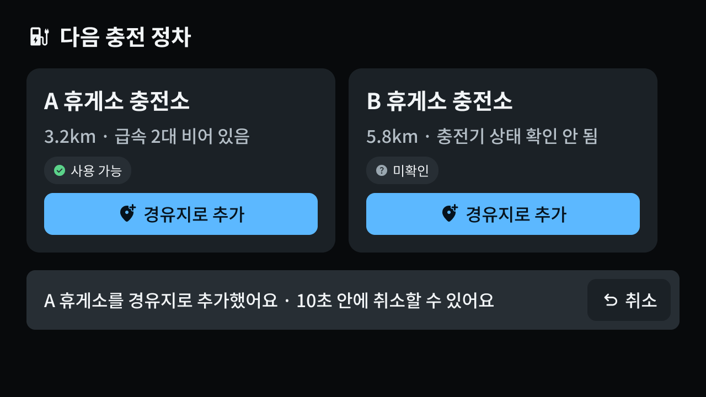
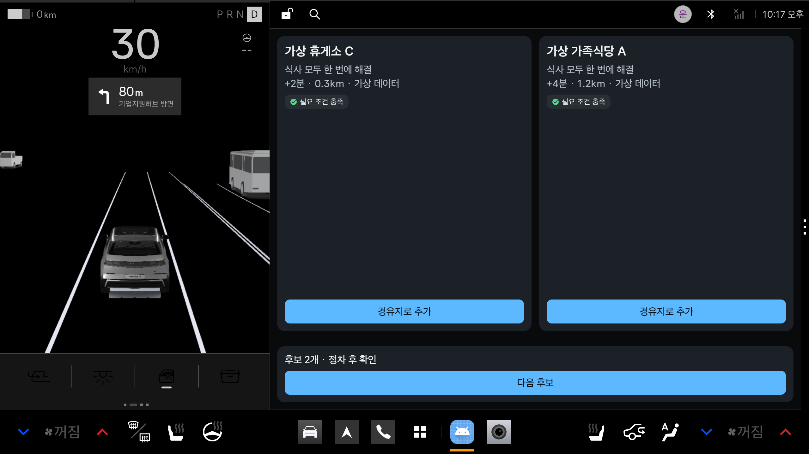
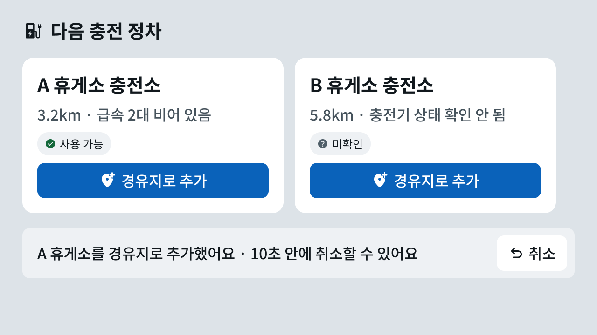
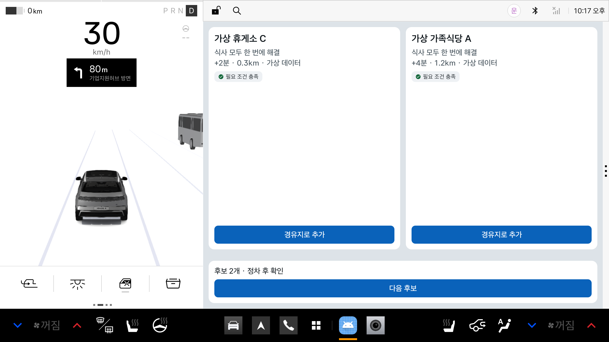
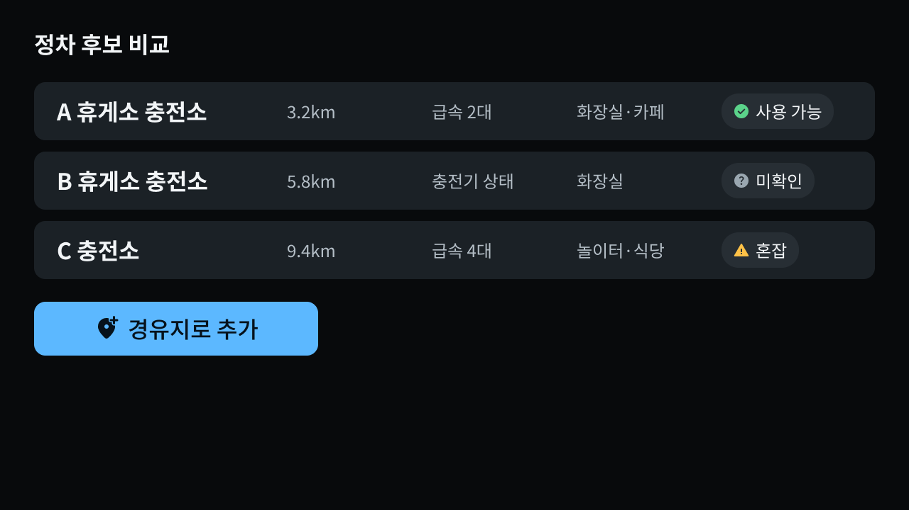
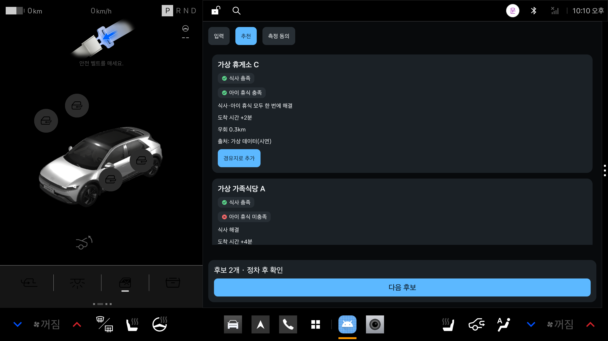
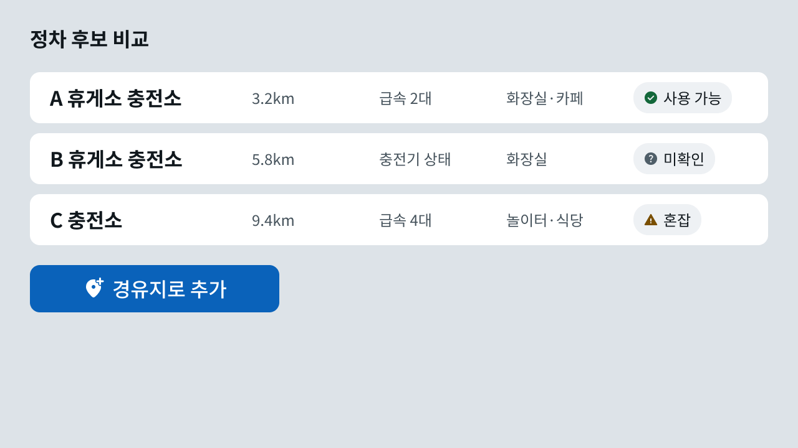
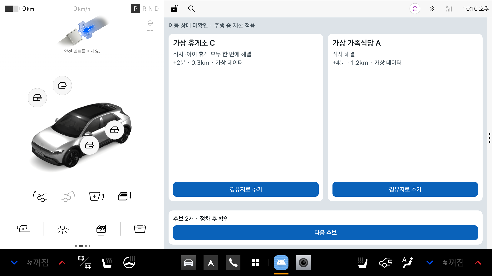

# 디자인 QA: 에뮬레이터 vs Figma (이슈 #45 후속)

2026-11-08. 에뮬레이터 `Pleos_Connect_v2_1_0`(2560×1440 mdpi), `adb shell cmd uimode night yes|no`, `scripts/vconsole.sh gear/speed`, `adb emu geo fix`. Figma: [Foundations/Screens](https://www.figma.com/design/So1tPxF3kWdBwk8WXf4Mfr?node-id=11-85) (`Screen / Driving·Parked / Night·Day`, 1280×720 임시 크기). 에뮬레이터 캡처는 `shots/`, Figma 캡처는 `figma/`.

## 나란히 비교 (왼쪽 Figma, 오른쪽 에뮬레이터)

| 화면 | Night | Day |
|---|---|---|
| 주행 · 카드 2개 |   |   |
| 정차 · 추천(비교) |   |   |

## 화면별 일치/불일치

| 화면 (feature) | 캡처 | 판정 | 내용 |
|---|---|---|---|
| 주행 카드 (drive) | `driving-cards-*` | **부분 일치** | 일치: 면 단계(base<surface), 글자 40/32sp, 버튼 높이 ≥76dp, 카드 간격 24dp, 상태 칩(아이콘+문구). 불일치: ① 버튼에 `add_location_alt` 아이콘 없음 ② 화면 상단 "다음 충전 정차" 헤더(아이콘+제목) 없음 ③ 카드 높이가 화면을 가득 채움(Figma 334 고정) |
| 주행 UndoBar·결과 줄 (drive) | 미캡처 | **미검증** | 경유지 추가가 성공하면 Pleos 내비가 전면으로 올라와 앱 화면을 캡처하지 못했다. 코드상 차이: Figma UndoBar는 `bg/raised` 면+undo 아이콘, 구현은 `bg/surface`+accent "취소(N초)" 버튼 |
| 주행 실패 안내 (drive) | 이번 빌드 수정 | **수정함** | 실패/완료 문구가 색만 다른 글자였다 → `StatusChip`(아이콘+문구)로 교체 |
| 정차 입력 (input) | `parked-input-*` | **일치** | 면 단계, 칩(선택=accent+체크 아이콘), 필드 border-less, 큰 주 버튼 |
| 정차 추천 (recommend) | `parked-recommend-*` | **불일치** | Figma는 `CompareRow` 표(3행: 이름·거리·충전·시설·상태 칩)+하단 버튼 1개. 구현은 카드 리스트(칩+세로 텍스트). DESIGN.md 7절의 CompareList/CompareRow가 미구현 → 후속 이슈 필요 |
| 폴백 (fallback) | `fallback-permission-*` | **일치** | 상태 칩(권한 꺼짐)+제목+문구+버튼 2개(주/보조), border-less 카드 |
| 충전 활동 (activity) | `parked-activity-*` | **일치(Figma 화면 없음)** | Figma에 해당 화면이 없어 토큰 기준(글자 24sp, 필드·버튼 ≥76dp)으로만 확인 |
| 동의 (metrics) | `parked-consent-*` | **일치(Figma 화면 없음)** | 위와 동일 |
| 핸드오프 (handoff) | 미캡처 | **미검증** | 성공 시 내비가 전면으로 올라와 캡처 실패. 실패 상태는 주행 화면에서 칩으로 확인 |
| 음성 바 (voice) | `driving-cards-*`, `parked-recommend-*` 하단 | **일치(Figma 화면 없음)** | 카드+큰 버튼 |
| 앱 셸 (app) | 모든 정차 캡처 상단 | **일치(Figma 화면 없음)** | 탭 버튼 ≥76dp, 간격 24dp |

## 터치 대상·간격·글자 확인 (캡처 기준)
- 버튼·칩·필드 높이: 모두 ≥ 76dp(2560×1440 mdpi에서 약 76px 이상으로 측정).
- 주행 중 큰 카드 2개, 스크롤·펼치기 없음, 한 번 탭.
- 상태 칩은 항상 아이콘+문구. 미확인은 `help` 아이콘+"미확인" (폴백 카드).

> 이슈 #50 일괄 점검: [audit.md](audit.md)

## 남은 일
1. `CompareList`/`CompareRow` 구현(정차 추천 화면) — 신규 이슈 필요(Figma 선행·`figma-done`).
2. 주행 카드 버튼 아이콘(`add_location_alt`)과 "다음 충전 정차" 헤더 — Figma에는 있으나 구현·DESIGN.md 컴포넌트 목록에 없음. 아이콘 벡터 추가 필요.
3. UndoBar·핸드오프·충전 활동(자동 확인) 화면은 내비 전면 전환을 피하는 캡처 절차(예: 내비 경로 없이 추가 실패 상태 유도) 확보 후 재캡처.
