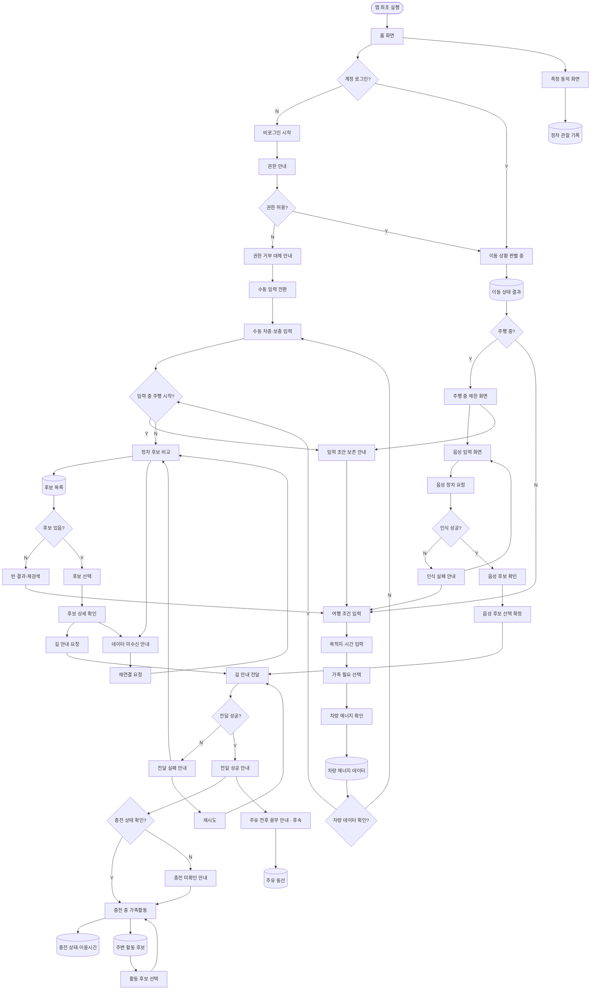

# 가족 여행 통합 정차 도우미 — Manyfast 내보내기 (2026-11-07)

출처: Manyfast 프로젝트 `c0e327fe-c754-41ac-a9fd-f9cbc58c803d` (제목이 프롬프트 문장 그대로라 이름 변경 권장)
기기: 차량 인포테인먼트 (Android 기반, Pleos Playground) · 역할: 운전자, 동승자 · 카테고리: lifestyle

---
## 1. PRD

**한 줄**: 전기차 가족 여행자가 식사·화장실·아이 휴식 + 필요한 충전을 함께 고려해 정차 후보를 비교·선택하고, 선택 장소를 길 안내로 전달한다.

| 항목 | 내용 |
|---|---|
| 목표 | 첫 시연에서 "입력 → 후보 비교 → 길 안내 전달" 핵심 흐름 + 주행 중 안전 제한 검증 |
| 사용자 문제 | 충전 조건과 가족 필요를 따로 찾아 비교해야 함 (빈도·크기는 미검증) |
| 해결 | 안전 정차 상태에서 목적지·가족 필요 입력 → 충전/경로 정보 기반 후보 비교 → 내비 연동 전달. 주행 중 상세 입력·비교 제한 |
| 차별화(가설) | 가족 필요 + 전기차 충전·경로 맥락을 하나의 후보 비교로 결합. 기존 내비/현대·기아 앱/지도 조합과 동일 조건 비교 전엔 우위 확정 안 함 |
| 타깃 | 전기차로 가족 여행하는 운전자·성인 동승자(충전 불필요 여행 포함). 자녀는 독립 사용자 아님. 내연기관은 후속 |
| 제외 | 주유 전후 안내, 차량 밖 복귀 알림, 예약·결제, 자체 지도/길 안내, 수익화 |
| KPI | 사전 목표값 없음. 계획 시간·선택 이유·미해결 필요 관찰, SDK 연계/가상 데이터 구분 기록, 모집 경로별 참여·지출 기록. MAU·Retention 목표 미설정 |
| 주요 리스크 | 소규모 표본 일반화 불가 / 선택 ≠ 실제 방문 / 재사용률 측정 불가(개인 연결 안 함) / 지도·서버 비용·상업 이용 조건 미확인 / 측정 동의 기준 |

**시연 범위**: 필요 입력 → 후보 비교 → 음성 선택 → 길 안내 전달 → 충전 중 가족 활동 안내. 충전 불필요 정차, 권한 거부, 데이터 미수신도 점검. 1차: 최소 동작 + 영상·소스·APK, 2차 PT 전: 핵심 SDK 연계·예외 대응 실제 앱 검증.

### 정책 (6)
- **PL-XOLZPM 평가 기준 대응**: 필수 4항목(차량특화성·창의성·기술 활용성·사업성), 배점 비공개. 안전·수익모델은 공식 항목 아님.
- **PL-THQNVU 제출물·단계**: 시연 영상·GitHub(소스+APK)는 선택 제출(가산점, 수치 비공개). 2차 PT 전 실제 동작 앱 완성. 숏폼 챌린지는 별도.
- **PL-GKZARO SDK/API 전제**: 외부 전송 항목·보존 조건 확인 전 실제 음성/개인정보 전송 시연 금지.
- **PL-UJFQXQ 주행 중 안전**: 주행 중엔 음성 입력과 확인·취소만. 동승자도 동일. 상태 미확인 = 주행 중과 동일 제한. 미확인 데이터는 사실처럼 표시 금지.
- **PL-CZHKED 운영·수익**: 무료 체험, 수익화 범위 밖. 유료 판매 가능 여부·비용 상한 미정(질문 열림).
- **PL-NGEOJQ 개인정보**: 여행 정보는 여행 중에만 임시 처리·종료 시 삭제. 측정 동의는 운전자 본인만, 철회 시 삭제.

---
## 2. 기능명세서 (7 요구사항 / 14 기능)

범례: 중요도 H/M/L · 진행 todo/done/blocked

### R-UWABZR 이동 상황 인식 및 이용 방식 전환 (H)
**F-GNGJMP 이동 상황 판별 (H, todo)**
- 입력: SDK 이동 상태값 우선(속도·기어 임의 사용 금지), 전기차 충전 상태. 앱 실행/상태 변경 시 갱신
- 출력: 주행/안전 정차/미확인 + 근거·확인 시각. 미수신·무효·모순 → 미확인
- 규칙: 새 상태 2초 유지 시 전환 확정, 그 전엔 더 제한적인 상태 유지
- 제외: 주차 직후 점검, 동승 자동 감지, 주유 완료 자동 감지
**F-OAXFEH 상황별 기능·상호작용 전환 (H, todo)**
- 주행/미확인: 음성 중심 최소 상호작용, 상세 입력·비교 차단. 정차: 상세 화면
- 주행 전환 시 입력 초안 보존 → 정차 후 이어 입력. 운전자·동승자 공유 화면 동일 제한

### R-ECJDUN 차량별 에너지 조건 및 정차 이용 지원 (M)
**F-QOZAMV 차량별 에너지 조건 확인 (H, todo)**
- 차종·보충 필요(필요/불필요/미정)·잔량 확인. 미수신/권한 거부 시 안전 정차 상태에서 수동 입력(자동값과 구분 표시)
- 수동 입력과 차량 데이터 불일치 시 안내. 잔량 미확인이면 도달 가능 보장 금지
**F-LFACHH 전기차 충전 중 가족 활동 안내 (L, done)**
- 충전 시작 확인(없으면 사용자 입력, '자동 확인 아님' 표시) → 주변 식사·간식·휴식 후보
- 활동 가능 시간 = 충전 종료 예상 − 왕복 이동 − 활동 소요 − 복귀 여유. 입력 미확인이면 완료 가능성 단정 금지, 정보 갱신 시 재계산
- 초기 시연은 직접 확인한 시연 구간 시설만. 성공 기준: 추천한 필요의 실제 해결률
**F-AKUFNL 내연기관 주유 전후 가족 용무 안내 (L, blocked)** — 후속 범위
- 주유 전후 시설 동선, 주유 구역↔가족 활동 주차 구역 구분. 주유 중 활동 유도·주유 시간을 활동 시간으로 취급 금지

### R-HMUJGM 통합 정차 추천·비교 및 길 안내 연계 (H)
**F-QTZQSN 가족 여행 통합 정차 추천·비교 (H, todo)**
- 후보 최대 3개(빈 결과 시 안내+재검색). 카드: 가족 필요 충족/미충족 → 추천 이유 → 도착 시간 변화 → 이동 부담(위계 순서)
- 주행 중 전체 비교·펼치기 불가. 확인 상태는 문구+아이콘(색만 의존 금지)
- 위치·목적지 외부 전송 전 항목·제공처·목적 고지 + 요청별 동의. 늦게 온 이전 응답은 현재 결과 덮어쓰기 금지
- 열린 질문: 목표 응답시간(3s/5s/측정 후), API 타임아웃(5s/10s/측정 후), 초기 데이터(외부 제공처 vs 실제·가상 혼합 — 추천: 혼합), 이동 중 재추천 시점(추천: 요청 시에만)
**F-JTGAFQ 선택 정차 지점 길 안내 전달 (H, todo)**
- NaviHelper SDK로 선택 장소 전달. 같은 장소 중복 요청은 병합. 성공은 응답 있을 때만, 실패는 재시도/비교 복귀
- 전달 성공 ≠ 방문·필요 해결. 열린 질문: 경유지+원 목적지 유지 지원 시 사용(추천), 동승자 경로 변경은 운전자 음성 확인 후(추천)

### R-AMGWHF 가족 여행 조건 및 정차 필요 설정 (M)
**F-GFBDZR 가족 여행 조건·정차 필요 입력 (M, todo)**
- 목적지·도착 희망 시간·식사/화장실/아이 휴식(복수 선택 + 긴급 여부). 계정 없이 시작, 정차 상태에서만 상세 입력
- 목적지 누락·지난 시간은 추천 전 수정 요구. 여행 정보는 여행 종료 시 삭제. 성공 기준: 수동 조합 대비 계획 시간 단축

### R-GXDQOA 안전·주의 분산 방지 및 예외 대응 (H)
**F-GFKMVI 주행 중 상호작용 제한 (H, todo)** — 상세 입력·후보 탐색 차단, 초안 보존, 차단 조작은 비활성+'정차 후 이용' 안내, 음성 입력·확인·취소만 활성
**F-JUUGZR 권한 거부 시 대체 동작 (H, todo)** — 기능 첫 사용 시 필요한 권한만 요청(일괄 요청 금지). 거부/철회 시 목적·제한·대체 방법 안내, 진행 작업 중단 후 자동 재개 안 함. 마이크 거부 → 정차 중 화면 입력
**F-JAYAOF 데이터 미수신·연결 실패 대체 동작 (H, todo)** — 실패 항목·제한 안내, 마지막 확인값은 출처·시각 병기(현재값 오인 금지), 재연결은 사용자 요청 시에만, 수동 입력 대체. 타임아웃 값은 프로토타입 측정 후 확정

### R-BTYZLN 음성 기반 상호작용 (L)
**F-GQEAGW 가족 정차 음성 요청 (L, blocked)** — 버튼으로 시작, SpeechToText SDK. 매 요청 외부 전송 고지·동의, 원본 음성·인식문 저장 안 함. 후보 1개면 확인 질문, 복수면 번호+구별 정보로 선택. 반복 실패 시 정차 후 화면 선택 안내
**F-LZMNLU 정차 추천·결과 음성 안내 (L, blocked)** — TextToSpeech SDK, 1~2문장, 내비 음성 우선. 주행 중엔 핵심 요약만. 열린 질문: 주행 중 후보 음성 안내 수(최대 2/3/1개씩 — 추천: 3), 출력 실패 대체(추천: 최소 상태+정차 후 상세)

### R-NTDPJV 정차 가치 및 반복 이용 측정 (L)
**F-QNPGYP 정차 가치·재사용 지표 수집 (L, blocked)** — 전기차 가족 체험 한정. 기존 방식 vs 시제품 계획 소요·선택 이유·미해결 필요, SDK 연계/가상 데이터 구분, 모집 경로별 참여·지출 기록. 개인 여행 연결 식별값 금지, 측정 동의는 운전자만, 수집 실패해도 핵심 기능 유지

---
## 3. 유저플로우

프로젝트에 플로우 2개(총 3버전). 최신인 **새 플로우 2 (11/04)** 를 기준으로 정리, **새 플로우 1 v2 (11/01)** 차이는 아래에 별도 표기. 두 플로우 모두 기능(F-)과 아직 연결되지 않음(referencedFeatureCount 0).

### 새 플로우 2 (최신)

섹션: 진입·권한 / 이동 상황 판별 / 여행 조건 입력 / 정차 추천·비교·길 안내 / 충전·주유 중 가족 활동 / 음성 상호작용 / 예외·지표 수집.

### 새 플로우 1 v2 와의 차이
- 로그인 분기 없음 — 홈에서 바로 권한 → 측정 동의 → 여행 조건 입력
- 주행 상태 판별을 후보 비교 이후 `주행 중 요약 화면`에서 수행 (플로우 2는 입력 전에 판별)
- 길 안내 성공 후 `주행 중 요약 화면`을 허브로, 거기서 음성 요청 / 전기차 충전 중 / 내연기관 주유 / 에너지 보충 없는 정차로 분기
- `에너지 보충 없는 정차 화면` 별도 존재 (충전 불필요 여행)
- 지표 측정 설정 → 이벤트 기록 상태 → 여행 후 조사 → 응답 제출 (여행 후 설문 포함)
- 권한 거부 시 `대체 입력 가능?` → 수동 위치 입력 분기

---
## 4. 확인 필요 사항
- 정책 PL-CZHKED의 열린 질문 2건(유료 전환 검토 방식, 월 비용 상한)과 F-QTZQSN/F-LZMNLU/F-JTGAFQ의 열린 질문들이 미결.
- 정책 PL-NGEOJQ의 한 섹션 라벨에 중국어 혼입("공용车辆与旅行隔离").
- 두 플로우 중 어느 쪽이 정본인지, 기능 ID와의 연결 필요.
- 중요도가 L/blocked인 음성·지표 기능(F-GQEAGW, F-LZMNLU, F-QNPGYP)은 시연 범위("음성 선택", "충전 중 안내")와 충돌 소지.
